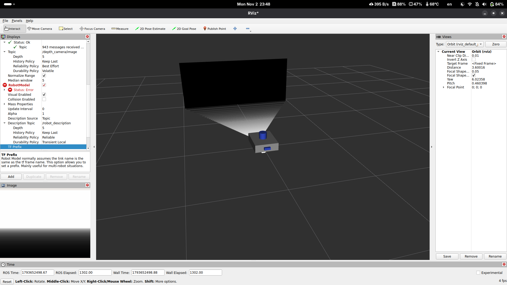
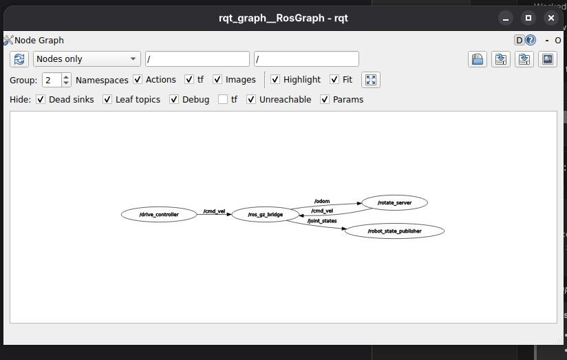

# Lab 1 Exercise: Program diffdrive_bot

**Course:** Introduction to Robotics and Intelligent Systems  
**Academic Year:** 2026  
**Program:** BSc in Software Engineering  

---

## Overview

This repository contains the completed solution for Lab 1 Exercise, consisting of four ROS 2 packages:

1. **`diffdrive_bot`**: The differential-drive robot model extended with a backward-facing depth camera and an IMU in the URDF, simulated in Gazebo Harmonic with sensor bridges.
2. **`lab_interfaces`**: Course-provided ROS 2 message, service, and action interfaces (`ObstacleInfo`, `SetSpeed`, `DriveDistance`).
3. **`my_robot_interfaces`**: Custom interface definitions developed for this exercise:
   - `msg/RobotStatus.msg`: Robot movement state and obstacle distance.
   - `srv/SetTurnSpeed.srv`: Service request to update turn speed with validation.
   - `action/Rotate.action`: Action specification to turn the robot by a commanded yaw angle.
4. **`my_robot_nodes`**: Python implementation of reactive navigation, service servers, action server, and high-level trajectory client:
   - `turn_away`: Reactive obstacle avoidance with dynamic parameter adjustment and status publishing.
   - `rotate_server`: Action server executing in-place rotation using incremental odometry yaw integration.
   - `square_driver`: Action client executing a square trajectory combining `/drive_distance` and `/rotate`.
   - `square.launch.py`: Integrated launch pipeline starting the simulation, rotate server, and square driver.

---

## Package Structure

```
lab1_exercise/
├── diffdrive_bot/
│   ├── config/bridge.yaml            # Configured bridges for depth camera & IMU
│   ├── urdf/diffdrive_bot.urdf.xacro # Depth camera & IMU links, joints, and Gazebo sensors
│   ├── worlds/obstacles.sdf          # Obstacle world with gz-sim-imu-system plugin
│   └── ...
├── lab_interfaces/
│   ├── action/DriveDistance.action
│   ├── msg/ObstacleInfo.msg
│   └── srv/SetSpeed.srv
├── my_robot_interfaces/
│   ├── action/Rotate.action
│   ├── msg/RobotStatus.msg
│   └── srv/SetTurnSpeed.srv
├── my_robot_nodes/
│   ├── launch/square.launch.py       # Master launch file
│   ├── my_robot_nodes/
│   │   ├── rotate_server.py          # Action server for /rotate
│   │   ├── square_driver.py          # Action client driving a square
│   │   └── turn_away.py              # Obstacle reaction & service node
│   └── setup.py
└── README.md
```

---

## Building the Workspace

Clone or place `lab1_exercise` into your ROS 2 workspace `src/` directory.

```bash
cd ~/ros2_ws
colcon build --symlink-install
source install/setup.bash
```

> **Note:** If `lab_01` exists elsewhere in your workspace `src` tree, ensure `lab_01/COLCON_IGNORE` is present so colcon builds this copy cleanly without package name collisions.

---

## Step-by-Step Execution & Verification

### Step 1: Depth Camera and IMU Sensor Integration

**Changes made:**
- In `diffdrive_bot/urdf/diffdrive_bot.urdf.xacro`:
  - Added `depth_camera_link` on the back face of the chassis ($x = -0.215\text{ m}$), turned half a turn about the z-axis ($rpy = 0\ 0\ \pi$).
  - Configured Gazebo `depth_camera` sensor publishing to `/depth_camera` at 10 Hz with `camera_info_topic` set to `/depth_camera/camera_info`.
  - Added `imu_link` at the centre of the chassis ($0\ 0\ 0$) with a Gazebo `imu` sensor publishing to `/imu` at 50 Hz.
- In `diffdrive_bot/worlds/obstacles.sdf`:
  - Added `<plugin filename="gz-sim-imu-system" name="gz::sim::systems::Imu" />`.
- In `diffdrive_bot/config/bridge.yaml`:
  - Added bridge mappings for `/depth_camera/image`, `/depth_camera/points`, `/depth_camera/camera_info`, and `/imu`.

**Verification:**
1. Check robot model in RViz:
   ```bash
   ros2 launch diffdrive_bot display.launch.py
   ```
2. Verify TF transform of the depth camera:
   ```bash
   ros2 run tf2_ros tf2_echo base_link depth_camera_link
   ```
3. Start Gazebo simulation and inspect sensor streams:
   ```bash
   ros2 launch diffdrive_bot gazebo.launch.py
   ```
4. Verify IMU publication rate and readings:
   ```bash
   ros2 topic hz /imu
   ros2 topic echo /imu
   ```

#### Step 1 RViz Screenshot:
*Below is the screenshot showing the simulated depth image and point cloud from the backward-facing camera:*



---

### Step 2 & 3: Turn Away Node and Dynamic Parameters

The `turn_away` node subscribes to `/obstacle` (`lab_interfaces/msg/ObstacleInfo`) and commands velocities on `/cmd_vel`:
- When clear (`too_close == false`): moves forward at `forward_speed` (default 0.2 m/s).
- When obstructed (`too_close == true`): turns on the spot away from the obstacle at `turn_speed` (default 0.5 rad/s).

**Execution:**
In terminal 1:
```bash
ros2 launch diffdrive_bot control.launch.py
```
In terminal 2:
```bash
ros2 run my_robot_nodes turn_away
```

**Testing dynamic parameters:**
```bash
ros2 param list /turn_away
ros2 param set /turn_away forward_speed 0.35
ros2 param set /turn_away turn_speed 0.8
```

---

### Step 4: Custom Message `RobotStatus`

Defined in `my_robot_interfaces/msg/RobotStatus.msg`:
```
string state
float32 obstacle_distance
```

The `turn_away` node publishes status messages on `/robot_status` with states `"forward"`, `"turning"`, or `"stopped"`.

**Verification:**
```bash
ros2 interface show my_robot_interfaces/msg/RobotStatus
ros2 topic echo /robot_status
```

---

### Step 5: Service Management (`turn_away_enable` & `set_turn_speed`)

The node provides two services:
1. `/turn_away_enable` (`std_srvs/srv/SetBool`): Starts disabled. When disabled, sends a zero velocity command and reports `"stopped"`.
2. `/set_turn_speed` (`my_robot_interfaces/srv/SetTurnSpeed.srv`): Updates the turn speed parameter, rejecting values $\le 0$ or $> \text{max\_turn\_speed}$ (default 1.5 rad/s).

**Verification:**
```bash
# Enable driving
ros2 service call /turn_away_enable std_srvs/srv/SetBool "{data: true}"

# Set a valid turn speed
ros2 service call /set_turn_speed my_robot_interfaces/srv/SetTurnSpeed "{turn_speed: 1.0}"

# Set an invalid turn speed (rejected by validation)
ros2 service call /set_turn_speed my_robot_interfaces/srv/SetTurnSpeed "{turn_speed: 2.5}"

# Stop the node
ros2 service call /turn_away_enable std_srvs/srv/SetBool "{data: false}"
```

---

### Step 6: Rotate Action Server

Defined in `my_robot_interfaces/action/Rotate.action`:
```
float32 angle
---
float32 turned
---
float32 turned
```

The `rotate_server` node turns the robot by the specified angle, publishing continuous progress feedback and returning total turned angle on completion or cancellation.

**Execution:**
```bash
ros2 run my_robot_nodes rotate_server
```

**Testing goal execution with feedback:**
```bash
ros2 action send_goal --feedback /rotate my_robot_interfaces/action/Rotate "{angle: 1.57}"
```

---

### Step 7: Square Driver Action Client and Launch File

The `square_driver` node sequentially calls `/drive_distance` (from `diffdrive_bot`) and `/rotate` 4 times to drive the robot around a closed square trajectory of side length `side_length` (default 0.5 m).

The consolidated launch file `square.launch.py` boots `diffdrive_bot`'s `control.launch.py`, the `rotate_server`, and the `square_driver`.

**Run the complete system:**
```bash
ros2 launch my_robot_nodes square.launch.py side_length:=0.8
```

#### Node and Topic Graph (`rqt_graph`):
*Below is the computation graph while `square.launch.py` is running:*



---

## Reflection: Challenges and Solutions

1. **Yaw Angle Wrap-Around Discontinuity ($-\pi \leftrightarrow +\pi$):**
   - *Issue:* Calculating turn angle simply as `current_yaw - start_yaw` fails when the robot crosses the $\pm\pi$ boundary, causing a sudden jump of $\approx 2\pi$ that prematurely trips or breaks the target threshold.
   - *Solution:* Implemented incremental differential integration using `angle_difference(curr_yaw, last_yaw)` in `rotate_server.py`. Each small angular step between odometry ticks is accumulated, correctly handling full turns and boundary crossings.

2. **Action Server Multi-threading & Deadlock:**
   - *Issue:* If single-threaded execution is used, processing the action goal loop blocks the odometry subscription callback from receiving new messages.
   - *Solution:* Assigned the odometry subscription and action server callbacks to a `ReentrantCallbackGroup` and executed the node with a `MultiThreadedExecutor`.

3. **Controller Arbitration on `/cmd_vel`:**
   - *Issue:* Multiple nodes (`drive_controller`, `turn_away`, `rotate_server`) write to `/cmd_vel`. If multiple publishers are active simultaneously, control commands fight each other.
   - *Solution:* Enforced strict single-driver execution. `drive_enable` from diffdrive_bot remains deactivated while custom exercise nodes run, and nodes zero out velocity on deactivation.

4. **Simulation Time Synchronization (`use_sim_time`):**
   - *Issue:* In Gazebo simulation, action goals can fail or timeout if nodes compute elapsed time using system wall-clock time rather than simulated clock time (`/clock`).
   - *Solution:* Explicitly declared and forwarded `use_sim_time: True` across nodes in `square.launch.py`.
